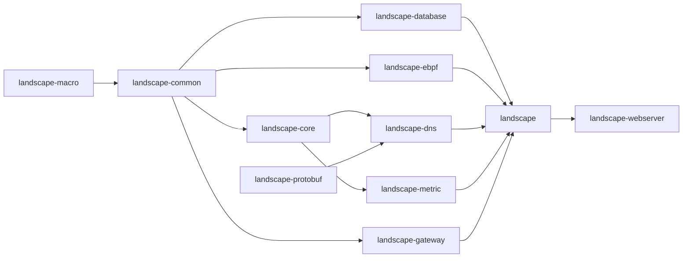

# Repository Guidelines

## Project Overview
Landscape: Linux router/network OS. Rust daemon (`landscape-webserver`) drives an eBPF dataplane (TC/XDP: NAT, firewall, routing, MSS, PPPoE), DNS server, DHCP/PPPoE/DDNS/ACME services and a reverse proxy. Configuration is stored in SQLite and served through an axum REST/WebSocket API. The Vue 3 web UI (`landscape-webui`) consumes that API through a TS client generated by orval (`landscape-types`).

## Architecture & Data Flow
Crate dependency direction (never import upward):



| Crate | Role |
|---|---|
| `landscape-common` | Domain types, config/CLI args, `ConfigStore` + controller traits, `ServiceManager`, `EventHub`, dataplane traits (`**/dataplane.rs`) |
| `landscape-core` | DB- and eBPF-free runtime logic (routes, `LanDeviceDirectory`, geo cache, `SyncTimeService`) |
| `landscape-database` | sea-orm 1.x on SQLite (WAL), repositories, `migration/` sub-crate |
| `landscape-ebpf` | libbpf-rs skeletons, map management, TC/XDP chain managers, `EbpfRuntime`; implements common's dataplane traits in `runtime_impls.rs` |
| `landscape` | Service implementations (`*Service`, `*ManagerService`), netlink, DHCP, PPPoE, DDNS, cert/ACME, docker |
| `landscape-webserver` | Sole real binary (`src/main.rs`): startup wiring, axum API, auth, OpenAPI |
| `landscape-dns` / `-metric` / `-gateway` / `-protobuf` / `-macro` | hickory DNS server; metrics (+sqlx persistence); Pingora/SNI proxy; pb-rs codegen; `LdApiError`/`LdCreate`/`LdUpdate`/`LdView` derives |

`src/bin/*.rs` in `landscape` and `landscape-ebpf` are test/demo tools, not the product.

**Startup** (`landscape-webserver/src/main.rs`): hand-built tokio runtime → `async_main` → args/env (`landscape-common/src/args.rs`, dotenvy) → `LAND_PATHS` (`landscape-common/src/paths.rs`) → `config` subcommand → `create_dirs` / `boot_check` → `RuntimeConfig::new_with_file_config` (CLI/env > `<config_dir>/landscape.toml` > defaults) → logger → `prepare_startup_init` (DB connect + `Migrator` up) → `run_system`: `EbpfRuntime::init` (bpffs `/sys/fs/bpf/landscape/<space>`), `EventHub`, every service built by explicit constructor injection inside `startup_phase!` → collected into `LandscapeApp` (`src/app.rs`, `Clone`, axum `State`) → `axum_server::bind_rustls` → `LandscapeApp::shutdown()` (30 s timeout).

**Filesystem layout** (`LandscapePaths`): default FHS dirs `/etc/landscape-router` (config), `/var/lib/landscape-router` (DB, init lock, metric, geo), `/var/log/landscape-router`, `/usr/share/landscape-router/static`, `/run/landscape-router` (sockets, API token, hostapd). `--config_dir`/`LANDSCAPE_CONF_PATH` or an existing `~/.landscape-router` puts everything under one dir. Never join file names onto a single "home" path: take the right dir from `RuntimeConfig.paths`, `LandscapeApp.paths` or `LAND_PATHS`.

**Config change flow**: API handler → `ConfigStoreController::checked_set` (persist to DB first) → `notify_changed` event over `EventHub` / mpsc, or `ConfigStoreServiceController` → `ServiceManager` (one restartable task per `service_key()`) → dataplane trait → eBPF maps. Reference: `landscape/src/dns/rule_service.rs`.

## Key Directories
- `landscape-common/src/service/{controller.rs,manager.rs}`: controller traits, service lifecycle.
- `landscape-common/src/error/mod.rs`: `LdApiErrorInfo`.
- `landscape-webserver/src/{openapi.rs,api.rs,error/mod.rs,auth}`: router assembly, `JsonBody` extractor, `LandscapeApiError`, JWT.
- `landscape-database/src/<table>/{mod.rs,entity.rs,repository.rs}`: one module per table; `migration/src/mYYYYMMDD_HHMMSS_<desc>.rs` + `migration/src/tables/`.
- `landscape-ebpf/src/bpf/*.bpf.c` (programs), `src/bpf/<area>/*.h` (headers), `src/bpf/tests/*/test_*.bpf.c`, `src/{stages,chain,maps/<domain>}/`.
- `landscape-webui/src/{lib,stores,views,components,i18n/{zh,en}}`.
- `landscape-types/src/mutator.ts` (axios instance, hand-written); `src/api/` is generated.
- `scripts/`: build, cross-compile, DB, vmlinux setup.

## Development Commands
```bash
pnpm install --frozen-lockfile          # JS deps (corepack pnpm preferred; scripts/pnpm_cmd.sh)
cargo build --workspace                 # plain `cargo build` builds only landscape-webserver (default-members)
cargo test --workspace                  # alias: cargo tt
sudo -E cargo test -p landscape-ebpf --features bpf-test   # alias: cargo ttb (root, loads BPF)
./fmt.sh                                # all formatters + clippy; flags --rust --clippy --c --frontend
cargo clippy --workspace --features metric-persistent -- -D warnings   # same as CI
./gen_ts_bindings.sh                    # OpenAPI -> landscape-types/openapi.json -> orval TS client
./web.sh                                # bindings (--if-stale) + Vite dev server (HTTPS, proxies /api,/ws to :6443)
pnpm --filter landscape-webui build     # vue-tsc && vite build
pnpm --filter landscape-webui run format:check
scripts/db/migrat.sh <name>             # new SeaORM migration (run from repo root)
scripts/db/up.sh / scripts/db/down.sh   # apply / roll back
bash scripts/init.sh                    # generate vmlinux.h
bash ./build.sh -t x86_64               # release bundle into output/ (x86_64|aarch64|armv7); not for every edit
bash ./scripts/package_deb.sh --arch x86_64   # output/ -> output/landscape-router_<ver>_<deb-arch>.deb
```
Cross/static builds: `scripts/build_musl_static.sh [triple]` (cargo-zigbuild, `STATIC=1`, `GATEWAY=1`), `scripts/build_gnu.sh <triple>`. `scripts/build_docker.sh` references a missing `dockerfiles/landscape/` (stale).

## Code Conventions & Common Patterns
- **Formatting**: rustfmt (`.rustfmt.toml`: `use_small_heuristics="Max"`, `struct_lit_width=50`, `reorder_modules`); taplo 4-space TOML; **clang-format 18 exactly** for `landscape-ebpf/src/bpf/**/*.{c,h}` (never `vmlinux.h`); Prettier for web UI (double quotes, semi, 2 spaces, width 80, trailing commas).
- **Lints**: clippy `-D warnings`; `dbg_macro` denied workspace-wide. New crates need `[lints] workspace = true` and `{ workspace = true }` deps declared in root `[workspace.dependencies]`.
- **Errors**: thiserror enums per domain deriving `LdApiError`:
  ```rust
  #[derive(thiserror::Error, Debug, LdApiError)]
  pub enum DnsRuleError {
      #[error("rule not found")]
      #[api_error(id = "dns_rule.not_found", status = 404)]
      NotFound,
  }
  ```
  New domain error → add a variant to `LandscapeApiError` and every match arm (`error_id`, `http_status`, `error_args`, `to_public_message`) in `landscape-webserver/src/error/mod.rs`. eBPF: `LandscapeEbpfError` / `LdEbpfResult` + `bpf_ctx!`.
- **API handlers**: per-domain `get_<domain>_paths() -> OpenApiRouter<LandscapeApp>` with `.routes(routes!(...))`; handlers take `State(state): State<LandscapeApp>` and `JsonBody<T>`, return `LandscapeApiResult<T>` via `LandscapeApiResp::success(data)`, annotated `#[utoipa::path(..., responses(body = CommonApiResp<T>))]`. Mounted under `/api/v1/<domain>` behind `auth::auth_handler`; WS under `/api/ws`. Schemas unreachable from routes go in `components(schemas(...))` in `openapi.rs`. Domain types: `#[cfg_attr(feature = "openapi", derive(utoipa::ToSchema))]`.
- **Async/tasks**: tokio. Spawn via `concurrency::spawn_task(task_label::task::X, fut)` or `ServiceHandle::spawn_task`; bare `tokio::spawn` escapes `wait_stop`.
- **State**: `Arc<ArcSwap<_>>` for hot-reloaded config; `EventHub` mpsc/broadcast (`subscribe_*()`); `watch` for WAN link state; `dashmap` / `Arc<RwLock<HashMap>>` in managers. No DI framework: constructor injection in `run_system`.
- **Database**: `entity.rs` defines `Model` + aliases (`XxxModel`, `XxxEntity`, `XxxActiveModel`, `XxxColumn`) and `From` conversions to/from the domain type; field aliases `DBId = Uuid`, `DBJson`, `DBTimestamp = f64`. `impl_repository!` requires `ValidatableConfig` + `StoreValidator` (`impl_trivial_validatable!` for no checks). `update_at: f64` is an optimistic-lock version; stale writes → `DbError::Conflict`. Writes go through `StoreWriter` / `txn_retry_loop!`. Register each migration manually in `migrations()` in `landscape-database/migration/src/lib.rs`. Do not upgrade sqlx past 0.8 or sea-orm to 2.x.
- **eBPF**: skeletons are included via `include!(concat!(env!("CARGO_MANIFEST_DIR"), "/src/bpf_rs/<stem>.skel.rs"))`. Map pins are `*_PIN` constants and paths come from `LandscapeMapPath::from_root`. Capability factories take `self: Arc<Self>` (`ebpf_rt.clone().nat()`); returned guards detach programs on drop. Services depend on dataplane traits only.
- **Naming**: `XxxService` / `XxxManagerService`, `XxxConfig` / `XxxRuntimeConfig`, `XxxError`, `XxxRepository`; crate-level types are prefixed `Landscape*` / `Ld*`.
- **Web UI**: Vue 3 SFC + naive-ui + pinia + vue-i18n (update both `zh` and `en`). Auto-imports cover `vue` and the naive-ui hooks (`auto-imports.d.ts` and `components.d.ts` are generated). Aliases: `@` → `src`; `@landscape-router/types` → `../landscape-types/src`.
- **Commits**: `<area>: <brief description>` (e.g. `ebpf: fix NAT4 rule leak on interface down`), one logical change per PR.

## Important Files
- Entry: `landscape-webserver/src/main.rs`, `src/app.rs`, `src/openapi.rs` (`export_openapi_json` test at ~L440).
- Config/env: `landscape-common/src/args.rs` (`DATABASE_URL`, `LANDSCAPE_WEB_HTTP_PORT`=6300, `LANDSCAPE_WEB_HTTPS_PORT`=6443, `LANDSCAPE_CONF_PATH`, `LANDSCAPE_EBPF_MAP_SPACE`, …), `landscape-common/src/paths.rs` (directory layout), `.env.example`, `landscape-common/src/config/loader.rs`.
- Packaging: `scripts/package_deb.sh`, `packaging/` (systemd unit `landscape-router.service`, deb maintainer scripts), `package-deb` job in `.github/workflows/build-and-release.yml`.
- Build: `Cargo.toml` (workspace, features), `.cargo/config.toml` (aliases, cross linkers, musl `-crt-static`), `landscape-ebpf/build.rs`, `landscape-protobuf/build.rs`, `landscape-types/orval.config.ts`, `landscape-webui/vite.config.ts`.
- Generated (gitignored; never hand-edit): `landscape-types/{openapi.json,src/api/}`, `landscape-ebpf/src/bpf_rs/`, `landscape-protobuf/src/protos/`, `landscape-ebpf/src/bpf/vmlinux.h`.

## Runtime/Tooling Preferences
- Rust **1.98.0** pinned (`rust-toolchain.toml`), edition 2024. Always pass `--workspace` when building or testing across crates.
- **pnpm** workspace (`landscape-webui`, `landscape-types`), Node ≥ 22. No Bun or npm/yarn.
- System packages: `cmake clang gcc make pkg-config libelf-dev libclang-dev zlib1g-dev` (+ `llvm curl zstd`). protoc is not needed (pb-rs).
- Runtime target: Linux ≥ 6.9 with BTF; root required to run the daemon and the eBPF/netns tests.
- `BPF_BUILD_JOBS` limits clang parallelism. Bump `SKELETON_GEN_VERSION` in `landscape-ebpf/build.rs` to invalidate the skeleton cache.
- Features: webserver default `gateway`, `metric-persistent` (+ `static`, `mem-track`); ebpf `bpf-test`, `static`; common `openapi`, `mem-track`; dns `pool-native` (default) / `pool-exp`. The database `postgres` feature is not wired up.
- After changing API routes or schemas, rerun `./gen_ts_bindings.sh`. `--if-stale` only checks that the output files exist.

## Testing & QA
- **Rust**: inline `#[cfg(test)] mod tests { use super::*; }` at the bottom of each file; `#[tokio::test]` for async tests. No rstest/proptest/insta.
- **Privileged tests** are marked `#[ignore = "requires root and veth pairs; run with --include-ignored"]`:
  - eBPF: `landscape-ebpf/src/tests/` (`cfg(all(test, feature = "bpf-test"))`), using `prog.test_run` with `etherparse` packets. Helpers: `test_support.rs` (`isolated_pin_root`, `ensure_bpffs`) and `tests/mod.rs` (`VethPair`, `NetNsGuard`, `TcEnv`).
  - PPPoE e2e: `cargo test -p landscape --test pppoe_e2e -- --include-ignored --nocapture` (root).
  - DNS upstream tests need `CAP_NET_ADMIN` (SO_MARK); without it they fail with EPERM instead of skipping.
- **Macro tests**: `landscape-macro/tests/*.rs`.
- **Config CLI e2e**: `cargo build -p landscape-webserver && ./scripts/config_cli_test.sh target/debug/landscape-webserver`.
- **Web UI**: Vitest, colocated `*.test.ts` (e.g. `src/lib/route_trace.test.ts`); `pnpm --filter landscape-webui test`.
- **CI** (`.github/workflows/check.yml`) runs `cargo check` and clippy (workspace + feature matrix: metric `--no-default-features`, webserver `--no-default-features`, common `mem-track` / `openapi`), `cargo fmt --check`, clang-format-18, Prettier check, `cargo test -p landscape-common --lib`, and the config CLI e2e. CI does **not** run the workspace tests, eBPF tests, DNS tests or Vitest; run them locally.
- **PR checklist** (`CONTRIBUTING.md`): `./fmt.sh`, `cargo tt`, `cargo ttb`, `format:check`, web UI build. There is no coverage threshold.
